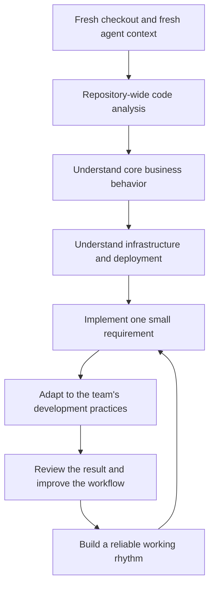
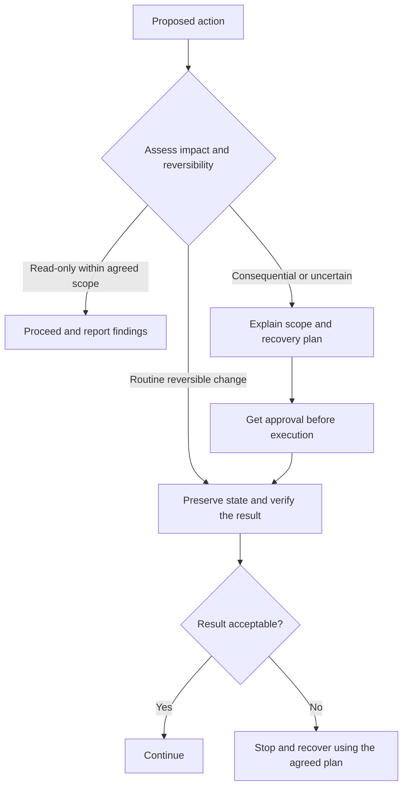

# Chapter 1: Let Go, Recognize Risk, and Communicate Clearly

*Draft · Based on my personal working practices.*

[中文对照](../zh-CN/01-working-with-ai.md) · [Contents](README.md)

I do not have a special trick for working with AI. I do not start by collecting MCP servers, skills, or plugins, either. Learning to work with AI is gradual, and the workflow has to fit the person using it.

I add integrations when a real task calls for them: Git, GitHub, Linear, Gmail, and so on. These tools give an agent access to more of my working environment. By themselves, they do not guarantee better judgment or better results. For me, adding them has been part of a more important process: gradually learning to delegate.

Developers tend to have strong engineering instincts and a healthy concern for safety. Those are valuable qualities. The adjustment is learning how to use them when we are no longer doing every step ourselves.

My approach comes down to three habits:

1. Let go of doing everything yourself.
2. Recognize risk and prepare a way back.
3. Communicate clearly, especially when something goes wrong.

## 1. Let go of doing everything yourself

Experienced engineers often want to control every detail. In systems work, that instinct can be useful. But when I work with AI, I try to act more like a technical lead: define the outcome, divide the work, remove blockers, and judge the result.

I do not want to become the bottleneck because I am attached to a clever line of code and keep rewriting it. My experience is more useful when I apply it to questions such as: Does this module meet the requirement? Is the behavior correct? What still needs to be checked?

### Review for outcomes

This can sound like stepping away from responsibility. I see it as changing where I spend my attention.

Neither handwritten nor AI-generated code can be exhaustively checked against every possible edge case. I therefore put more emphasis on validating behavior, in a way that resembles QA: the core user journey must work, the important failure paths must be considered, and the implementation must stay aligned with the actual request.

That does not make code quality, security, or architecture irrelevant. It means I start with the intended behavior and focus deeper review on the parts whose failure would matter most. I do not need to design every conceivable test case myself, but I do need evidence that the core requirement has been met.

### Make room for deliberate cleanup

Code deterioration is real. In my experience, rapid AI-assisted changes can make it worse when no one steps back to examine the whole system.

My preference is to schedule focused cleanup after a substantial version lands: separate modules, simplify code, and remove accumulated complexity. AI can do much of that work, too. I would rather make it an explicit task than repeatedly interrupt delivery for speculative optimization.

This is a sequencing preference, not a reason to defer known correctness or security problems. A defect that threatens the current release should be addressed in the current release.

### Treat a fresh agent like a new teammate

I particularly like starting with a freshly checked-out repository and an agent that has no accumulated conversational memory. A clean context gives us a chance to examine the code without carrying forward every assumption from earlier sessions.

My usual sequence is:

It feels much like onboarding a new teammate. In my own experience, this can move surprisingly quickly—sometimes roughly a week from unfamiliarity to making meaningful contributions. That is a personal observation, not a promise that every repository or task will follow the same timeline.

During that process, I regularly ask the agent to teach me: What does this business function do? Why was it introduced? Does it still serve the current need, or should it change?

### Keep knowledge close to the code

I treat the repository as the primary source for understanding implemented behavior. Before building a large separate knowledge base, I want the agent to inspect what actually exists.

I have found that fixed summaries can turn into inherited assumptions. If they are not maintained, the agent may repeat an old explanation instead of checking whether it is still true.

That does not mean all documentation is wasted effort. Code shows what the system does; concise documentation can preserve intent, constraints, and decisions that the code alone cannot explain. My preference is to keep that material small and connected to the work.

A task file and a memory file can be useful working references: current goals, decisions, mistakes, and lessons from recent tasks. They should not grow forever. I periodically ask the agent to check them against the repository, remove stale material, and keep only what will help the next task.

## 2. Recognize risk and prepare a way back

This is where engineering experience becomes especially valuable. Years alone are not the point. Familiarity with operating systems, networks, databases, and algorithms gives you a wider sense of what is possible—and what can go wrong.

I think of that as technical imagination.

One person might ask, “Make my computer easier to use.” Someone with more system knowledge might ask, “Help me understand and reduce unnecessary memory usage,” or, “Let me use an AI agent on one computer to operate several other machines.”

The difference is not just vocabulary. Knowing that remote access and SSH exist changes the solutions you can imagine. Knowing how state, resource ownership, and cleanup work changes the failures you can recognize.

### Notice when the agent takes a wrong turn

Consider a React effect that repeatedly triggers itself, or one that starts subscriptions or asynchronous work without appropriate cleanup. Someone unfamiliar with the mechanics may only see a slow interface, stale state, or a frozen application. An experienced developer has more useful hypotheses to investigate.

I do not expect to inspect every implementation detail manually. Often, the agent identifies these problems before I do. But I still watch for a change in direction: lost constraints after a long conversation is summarized, repeated failed attempts, or a workaround that solves one obstacle by creating a larger problem.

At that point, a timely intervention can be simple:

> Stop here. The failed approach does not justify changing that constraint. Try the original path again, or tell me what access or information you need from me.

Experience helps me interrupt unproductive work. It also helps me distinguish a small, recoverable mistake from a genuinely dangerous operation.

### Plan recovery before a consequential change

“Make a backup” is useful, but incomplete. I also want the agent to explain how we would restore the previous state.

Depending on the task, that might involve a Git revert, a database backup with a tested restoration procedure, a snapshot, or a rollback script. These mechanisms solve different problems; a code revert, for example, does not restore deleted production data.

Before a consequential operation, I want to understand:

- What will change, and what could be affected?
- What state needs to be preserved?
- How will we recover if the operation fails?
- Which step requires my approval?

### Delegate access with clear boundaries

I am comfortable giving an agent access to work resources when the boundaries are explicit: mostly read-only access, limited write permissions, and consultation before consequential changes.

A clear instruction helps, but I do not treat a sentence in a prompt as a guarantee. Available permissions and the agent's execution controls should support the same boundary.

This is a significant step toward useful delegation. For example, a Slack summary can tell me what colleagues discussed. An agent with access to both the conversation and the repository can go further: investigate how a customer's article is actually processed, find the relevant implementation, and explain the answer with supporting evidence.

The benefit comes from connecting the question to the right context, while keeping access proportional to the task.

## 3. Communicate clearly, especially when frustrated

Everyone gets frustrated. I have been angry when an agent seemed less capable than expected, repeated mistakes, or spent its time apologizing instead of moving the work forward.

I cannot establish from those experiences that a provider switched me to a weaker model because I was angry. What I can observe is that an exchange full of accusations and apologies gives us less useful information to work with.

Insults do not explain the bug, restore a missing constraint, or define an acceptable result. They add conversation without helping the next decision.

Instead, I try to make the correction concrete:

> Stop. The result violates this requirement: ___. Preserve the current state, explain what changed, and propose the smallest correction. Ask before taking any irreversible action.

The agent needs a clear objective, relevant context, and a way to tell whether the result is acceptable. When those are in place, I can give it room to continue without checking every step.

If it asks a multiple-choice question and every option is wrong, I do not force the task into one of those options. I explain the missing requirement and ask it to reassess the work already completed against that requirement.

For me, learning to work with AI has meant gradually shifting from doing every step to directing the work: giving it room, recognizing when to intervene, and making each intervention useful.
