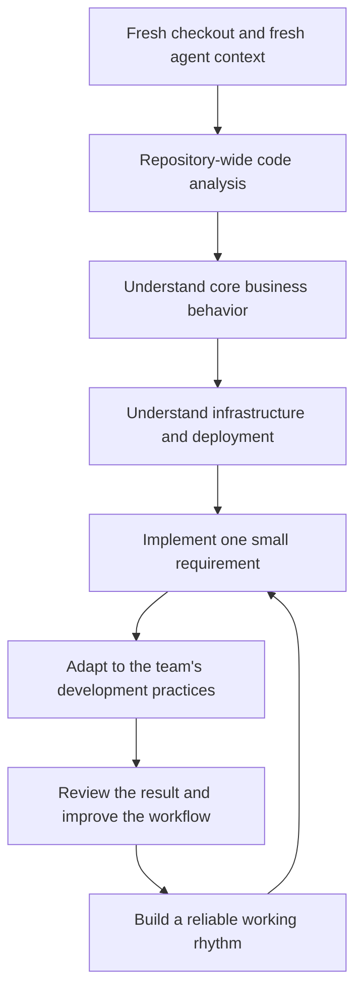
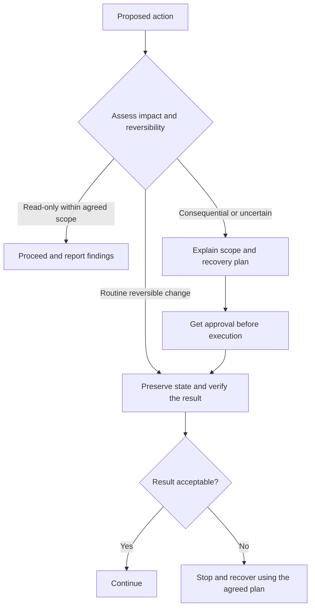

# Chapter 1: Let Go, Recognize Risk, and Communicate Clearly

*Draft · Personal working practices.*

[Contents](README.md)

I do not have a special trick for using AI. I add tools such as GitHub, Linear, and Gmail only when real work calls for them. Integrations expand what an agent can access; learning to delegate changes how much work I can actually hand over.

For me, that comes down to three habits: **let go, recognize risk, and communicate clearly.**

## 1. Let go: direct the work, judge the result

Experienced engineers like to control the details. With AI, I try to act more like a technical lead: define the outcome, divide the work, and remove blockers. Repeatedly polishing a clever implementation should not make me the bottleneck.

My review starts with behavior: **Does the core journey work? Does it meet the requirement? Have the important failure paths been checked?** Code quality still matters, and high-risk areas deserve deeper review. But I do not need to personally rewrite every line to take responsibility for the result.

I prefer focused module cleanup and simplification after a substantial release, rather than speculative optimization throughout delivery. Known correctness and security problems still need attention immediately.

### Onboard the agent through real work

I like a fresh checkout and a fresh agent context. Then I follow a sequence much like onboarding a teammate:

In my experience, roughly a week can be enough to move from unfamiliarity to meaningful contributions. Along the way, I ask the agent to teach me what each business function does, why it exists, and whether it needs to change.

**The code is my starting point for knowledge.** Documentation should preserve intent and constraints, not replace checking the implementation. I keep useful decisions and lessons in task and memory files, and periodically ask the agent to remove stale or redundant material.

## 2. Recognize risk: know when to intervene

Engineering experience gives us technical imagination: a sense of what is possible and what might break. Knowing about memory, networks, or remote access lets us ask for more specific outcomes—and recognize when an agent takes an unreasonable shortcut.

I watch for lost constraints, repeated failures, and workarounds that create bigger problems. A useful intervention is simple:

> Stop here. Keep the original constraint. Retry that path, or tell me what information or access you need from me.

**Before a consequential change, I want a recovery plan—not just a backup.** What could be affected? What state must be preserved? How would we restore it? A code revert cannot recover deleted production data.

I delegate access with explicit boundaries: mostly read-only, limited writes, and approval before consequential changes. Instructions help; actual permissions and execution controls must support them.

The payoff is context. An agent that can read both a colleague's question and the repository can investigate how a customer's article is processed, instead of merely summarizing the conversation.

## 3. Communicate clearly: turn frustration into instructions

I have been frustrated by repeated mistakes and endless apologies. But anger does not tell the agent what to fix. I cannot infer from a bad interaction that a provider downgraded the model; I can see when the conversation stops producing useful information.

Instead of an accusation, I give a concrete correction:

> Stop. This violates the requirement: ___. Preserve the current state, explain what changed, and propose the smallest correction. Ask before irreversible actions.

If every option in the agent's question is wrong, I explain the missing requirement and ask it to recheck the work already done. A clear goal, relevant context, and a definition of success give it room to keep working.
