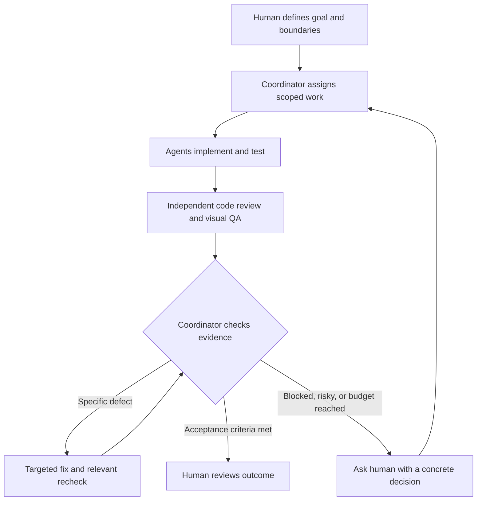

# Chapter 2: Let Agents Keep the Work Moving

*Draft · Personal working practices.*

[中文对照](../zh-CN/02-agent-loops.md) · [Contents](README.md)

Once I can delegate a task, the next step is to stop being the messenger between every stage. **An agent should be able to assign work, inspect the result, and decide what comes next—within boundaries I have already set.**

## 1. Put judgment at the center

I want a strong decision-maker coordinating the work. My current preference is Opus 5.5: in my own work, its cost and execution efficiency make it attractive, sometimes even preferable to Fable. That is a workload-specific judgment, not a universal ranking. [Anthropic's model information](https://www.anthropic.com/claude/opus) provides the current product details.

The setup can take different forms: Claude Code subagents, a router built around Hermes, or a coordinator authorized to invoke Codex and Cursor agent CLIs. These are alternative integration approaches, not interchangeable out-of-the-box configurations.

| Role | What I delegate |
|---|---|
| Coordinator | Break down requirements, route work, assess evidence, escalate decisions |
| Implementation agent | Make a bounded change and return the diff and test results |
| Independent reviewer | Examine requirements and code in a separate session |
| Visual QA agent | Exercise the UI and collect screenshots or selected recording frames |
| Human | Judge the outcome, resolve ambiguity, approve consequential actions |

I would use a lower-cost model such as Sonnet for well-scoped review or visual QA when it performs adequately. Browser tooling can supply interaction and screenshots; recording and frame extraction require an appropriate capture workflow. Images help reveal UI problems, but do not replace functional checks.

## 2. Close the loop, with a stopping rule

Each handoff needs a clear requirement, scope, and definition of done. The coordinator should receive evidence, not just “finished.” Separate worktrees or clear file ownership help keep simultaneous agents from overwriting each other.

For routine changes, my default is **one independent review pass**, followed by targeted fixes and verification. More review is justified by new evidence, substantial changes, or higher risk—not merely because another agent is available.

Repeatedly passing the same explanations between agents can reinforce shared assumptions. I prefer giving the reviewer the requirement, diff, and test evidence before the implementer's defense of its choices. Agreement is not proof; a reproducible finding is more useful.

## 3. Keep operational context fresh

I also use agents for recurring inspections: recent errors, failed jobs, and changes since the last check. This reduces the amount of context I have to reconstruct when a problem appears.

The useful output is a **timestamped summary with links to fresh evidence**, not an ever-growing dump of logs. A scheduled check only knows what it last observed. Keep routine inspection read-only, report meaningful changes, and route proposed fixes through the same decision loop.

## 4. Stay reachable without staying at the desk

My personal project, [pane-remote](https://github.com/mowtwo/pane-remote), lets me manage computer sessions from my phone. It is the human access layer around this workflow, not the decision-making model itself.

- **One place to intervene:** session status, an inbox of pending actions, and completion or approval notifications.
- **Context stays accessible:** Claude Code and Codex conversation views, session forks, and terminal access.
- **Review from the phone:** preview local development pages and files; an injected agent can ask a question or open a preview for me.
- **A recovery path:** diagnostics, guarded updates, and rollback support make maintenance easier.

I built it with AI. For an experienced engineer who already has the prerequisites, the extra deployment effort can feel close to zero. That is my experience, not a zero-cost guarantee: the documented setup needs macOS, WezTerm, and a suitable Tailscale configuration, with additional dependencies for optional modules.

Its incident workflow captures another useful loop: **detect → deduplicate → notify → approve a repair → let an agent fix it → report back**. I can leave the desk without making every pending decision wait until I return.

*Implementation references: [agent integration](https://github.com/mowtwo/pane-remote/blob/main/docs/en/agent.md), [incident handling](https://github.com/mowtwo/pane-remote/blob/main/docs/en/incidents.md), and [update logic](https://github.com/mowtwo/pane-remote/blob/main/lib/update.mjs). Features checked against the local source on October 28, 2026; deployment was not retested for this chapter.*
