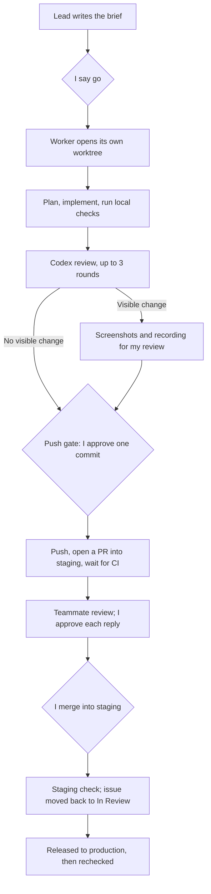
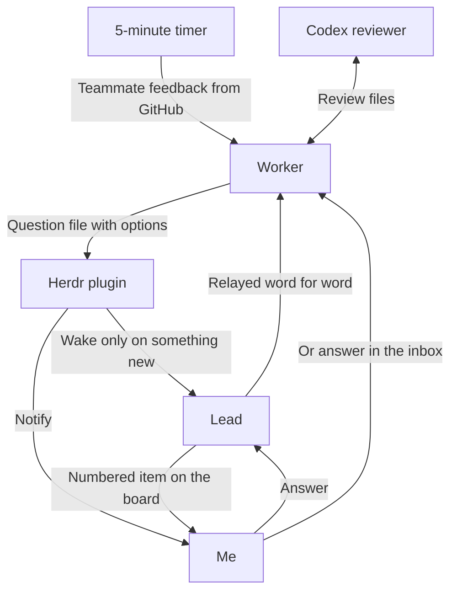
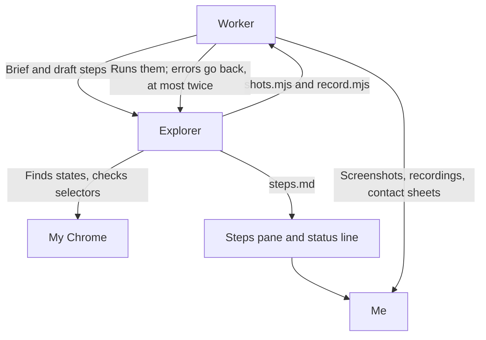

---
authors:
  - Kaibin Chen
---

# Chapter 4: One Board Agent, Many Workers

[Contents](README.md)

## The problem

I usually have several issues in progress at once, and each one needs an agent working in its own copy of the code. Someone has to coordinate those agents: decide what can start, notice when one is stuck, and collect the questions only I can answer. I wanted that coordinator to be an agent too, one that acts as a **board**: it triages, dispatches, and watches, but does not write code.

[Chapter 2](02-agent-loops.md) describes the principles of a coordinating agent. This chapter is one concrete setup, built on [Herdr](https://herdr.dev), an agent multiplexer that runs in the terminal.

The configuration lives in the agent-flow repository, which will be shared inside RankAI. File paths below are relative to that repository.

## My approach

### Roles

| Role | What it is | What it does | What it may not do |
|---|---|---|---|
| Lead | Claude with the `rankai-lead` skill, in its own Herdr workspace | Triages Linear, Slack, and GitHub into a board; writes a brief for each ready issue; starts a worker when I approve; watches workers; cleans up after merge | Write code, push, post without my "send", change issue status or owner, answer for me |
| Worker | Claude with the `rankai-ticket` skill, one per issue, in its own worktree | Everything inside the issue, from brief to merge | Leave the issue's scope, push without my approval |
| Reviewer | Codex, read-only, in a pane beside the worker | Reviews the branch, up to three rounds | Change code; its "ship" is not my approval |
| Visual check | By default the worker itself, writing Playwright scripts to the `visual-check` skill; when a state is hard to find, a second Claude (the explorer) in its own Herdr tab, driving my Chrome through Playwright MCP | Maps every place the change shows up, keeps a steps list, takes screenshots and recordings; the explorer finds the states on the real page, checks selectors, and writes the scripts | Click anything in production; deliver its own screenshots (every delivered file comes from one shared script helper, so sizes and marks stay consistent) |
| Me | — | Every decision: start, push, merge, external posts, answers | — |

In the first version, one agent both dispatched and wrote code. Splitting them keeps code out of the lead's context, so the lead can run for days, and keeps each issue isolated from the others (`docs/DESIGN.md`). At most three issues run at once.

### One issue, end to end

The stages and their checks are in `skills/rankai-ticket/SKILL.md`. Review rounds follow `skills/codex-review/`, and the screenshot standard is in `skills/visual-check/`.

### How messages move

Handoffs happen through files, one directory per issue: the brief, a status line, questions with explicit options, and review requests and results. Agents do not depend on remembering each other's conversations.

The Herdr plugin (`herdr-plugin/`) runs a check whenever an agent's status changes and wakes the lead only when something new happened: a question, a worker that stopped or stalled, or a stale lock. A timer polls every PR of each active issue every five minutes and sends teammates' review comments straight to that issue's worker, as links rather than paraphrases. Items waiting on me get a number and a short label on the board. Numbers are never reused, and closed items move to an archive.

### How a visual check runs

For a visible change, the worker produces before and after screenshots and a recording before the push, to one standard: desktop screenshots at 1920×1080 with a red box on the changed element, a mobile view at 375×812, and H.264 recordings with a visible pointer. Every file comes from one Playwright helper (`skills/visual-check/scripts/visual.mjs`); the scripts for an issue only open pages, click, and name elements.

1. **Preflight**: ffmpeg, ImageMagick, Playwright, and the display height; when the explorer will be used, one probe of the Playwright MCP extension in Chrome.
2. **Coverage map**: every page and state where the change shows up, read from the code rather than the brief, with signed in or signed out noted.
3. **Steps list**: one file, `steps.md`, one line per page or action, written in Chinese with the URL and selectors, and a mark at the end of each line: `→` running, `✓` reached, `✗` not reached. The same file shows in three places: a pane in the top right of the Herdr tab that redraws on every change, the agent's task list, and `visual n/N` in the status line. I follow pages and steps, not the agent's reasoning.
4. **Scripts**: by default the worker writes `shots.mjs` and `record.mjs` itself and runs them. The explorer starts only when a state is hard to describe, such as where to click in a signed-in dashboard or which project shows it. It opens its own tab in my Chrome, reads pages as accessibility snapshots, finds the states, checks selectors, completes the steps list, and hands the scripts back. The worker runs them; on an error it sends the output back to the explorer for a fix, at most twice, and then asks me.
5. **Checks**: every file is checked for size, codec, and the box; each recording gets a contact sheet with a frame every two seconds, to confirm that the actions really happened.
6. **Delivery**: the recordings go into the PR description.

## Human judgment and validation

The agents carry the work, but these steps wait for me:

- **Start**: a worker begins only after I approve the brief.
- **Push gate**: the worker shows me the commit; my approval names that commit's SHA and covers nothing else. Pushes are capped at about ten a day, because every push runs CI.
- **Screenshots**: for a visible change, I look at the before and after images and the recording before the push. While the explorer works, I follow the steps list in the Herdr pane and watch what it does in my Chrome; it does not touch tabs I already have open. Steps that need a sign-in or a payment are designed to pause the script and wait for me, which has not yet been verified on a real issue.
- **Replies and mentions**: the worker shows me a draft before it answers a review comment or posts anything that mentions someone or asks for a decision. Routine progress comments on the issue go out at milestones without a draft.
- **Merge**: I merge into staging myself. The production release goes through the team's normal process.

A Codex "ship" verdict means the reviewer and the worker agree. It does not replace my approval.

## Results and limitations

Most rules came from things going wrong in real use, and the repository history records each change. Three examples:

- The lead took screenshots for an issue itself, and its context filled up within hours. Since then, the lead does no work inside an issue, and workers ask me their questions directly.
- Board items carried only a number, and I could not tell what an item meant without looking it up. Every item now has a label, and numbers are never reused.
- A worker treated configuration risks outside its issue as part of the job, and the team lost a day. Briefs now quote the issue's definition of done and list what is out of scope; anything found outside the scope becomes a separate follow-up issue.

The workflow does not fit every task. Research where I have to run the experiments and make the judgment myself goes outside it.

The visual check has been through three versions. The first relied on computer use: some runs produced no screenshots at all, and the sizes and sharpness varied. On 28 October it moved to Playwright scripts on one shared helper, which produced the recordings in the PR description for RAN-525. On 30 October the explorer ran end to end for the first time, against this workbook's local dev server: 60 screenshots and a 23-second recording, with two rounds of script fixes along the way. In one, the scroll wheel landed on the sidebar and the main text never moved; in the other, the browser profile remembered the language the site had saved, so every later run opened the Chinese home page and the script could not find the English link. This path has not yet been verified on a signed-in RankAI page or a payment step.
