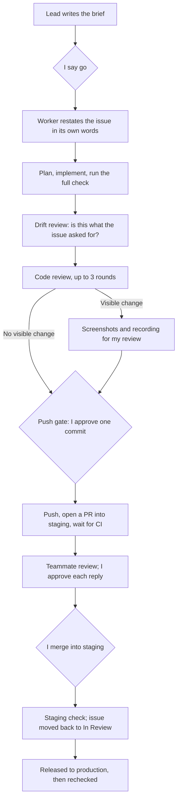
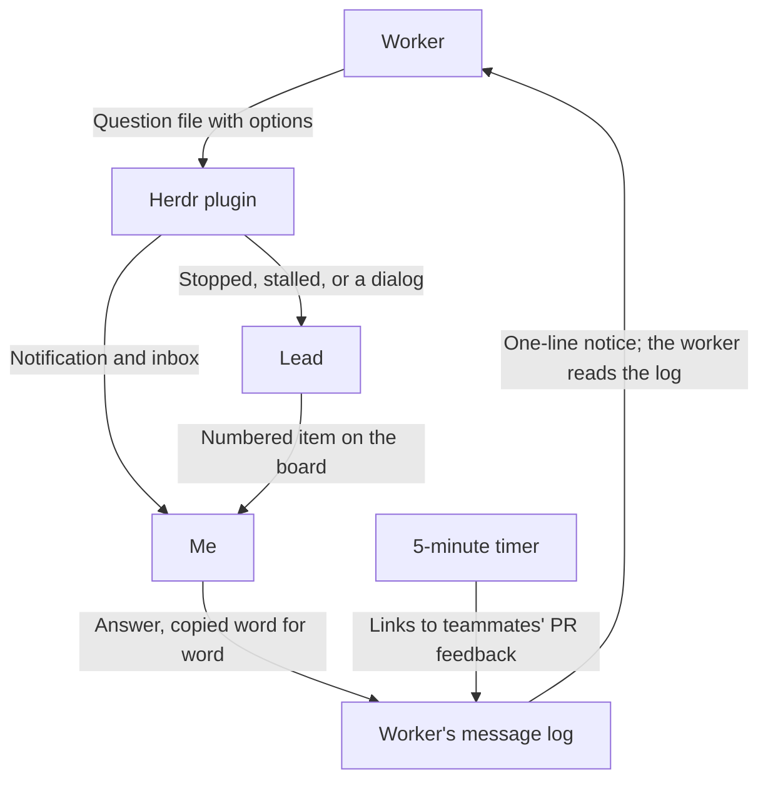
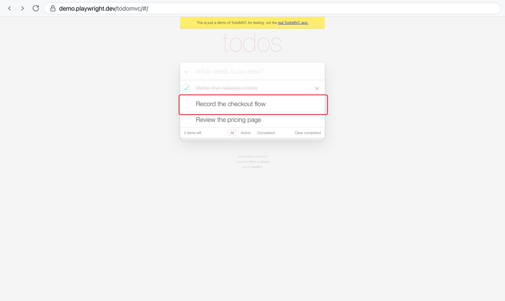

---
authors:
  - Kaibin
---

# Chapter 4: One Board Agent, Many Workers

[Contents](README.md)

## The problem

I usually have several issues in progress at once, and each one needs an agent working in its own copy of the code. Someone has to coordinate those agents: decide what can start, notice when one is stuck, and collect the questions only I can answer. I wanted that coordinator to be an agent too, one that acts as a **board**: it triages, dispatches, and watches, but does not write code.

[Chapter 2](02-agent-loops.md) describes the principles of a coordinating agent. This chapter is one concrete setup, built on [Herdr](https://herdr.dev), an agent multiplexer that runs in the terminal. It lives in the [agent-flow](https://github.com/RankaiHQ/agent-flow) repository, which is shared inside RankAI: a set of skills and a Herdr plugin, with every name, path, and limit in one config file.

## My approach

The two rules I care about most: the agent that dispatches never touches code, and agents hand work to each other through files, not memory. The first lets the lead run for days. The second lets any agent pick up from the files after a restart. Most of the other rules follow from these two, including the parts added since the first version: a role that only reads, and a log for every message a worker receives.

### Roles

Herdr has four layers, and the roles below live on different ones: the lead has a workspace of its own, each issue's worker has a worktree workspace, and a review shows up as a pane beside the worker.

<HerdrLayers lang="en" />

| Role | What it is | What it does | What it may not do |
|---|---|---|---|
| Lead | Claude with the `rankai-lead` skill, in its own Herdr workspace | Triages Linear, Slack, and GitHub into a board; writes a brief for each ready issue; starts a worker when I say go; tells me when a worker stops or stalls; cleans up after merge | Write code, push, post without my "send", change issue status or owner, answer for me |
| Worker | Claude with the `rankai-ticket` skill, one per issue, in its own worktree | Everything inside the issue, from the brief to the checks after merge | Leave the issue's scope; push or post without my approval |
| Scout | Claude with the `rankai-scout` skill, one per question, in a checkout it may not change | Answers one question by reading: code, other repositories, the web, the staging database with SELECT only. Writes a report with a source for every fact, and a summary of at most ten lines | Change or send anything; decide what to do with the answer |
| Reviewer | Codex, read-only, run by the worker; a pane beside the worker shows each round | Two reviews before a push: first whether the change is what the issue asked for, then the code. Up to three rounds each | Change files; its "ship" is not my approval |
| Plugin | A Herdr plugin: scripts, no model | Notifies me when a worker has a question; wakes the lead when a worker stops, stalls, or hits a dialog; passes teammates' PR feedback to the right worker; shows each worker's stage in the sidebar | Approve or answer anything |
| Me | — | Every decision: start, push, merge, external posts, answers | — |

In the first version, one agent both dispatched and wrote code. Splitting them keeps code out of the lead's context and keeps each issue isolated from the others. At most three issues run at once; scouts do not count toward that limit. With one issue in review, the screen looks like this:

<HerdrScreen lang="en" />

### One issue, end to end

The worker moves through ten numbered stages and writes the current one into a one-line status file. The lead, the plugin, and the sidebar read that line, not the worker's screen.

Several steps in the chart were added after a miss. The drift review exists because a code review cannot tell whether the change is the one the issue asked for. Before the push gate, the worker now checks for conflicts with the base branch: one push landed on a PR that had started to conflict an hour earlier, CI never ran the tests, and the push was spent for nothing. And "CI is green" now means one named check, the one that runs the tests, after the lead reported a PR as all green when only the preview deployment had passed.

### How messages move

Handoffs happen through files, one directory per issue: the brief, the status line, questions with explicit options, review requests and results, and a log of every message sent to the worker. Agents do not depend on remembering each other's conversations.

Two details here came from failures. First, my answer is copied, never retold. When the lead paraphrased, it got it wrong twice; once it took the grey placeholder text in a worker's input box for something I had typed. Second, a message that was sent has not necessarily been read. An answer typed into a busy worker's input box could be cut off or lost, so every message is now appended to a log, the worker's pane gets a one-line notice, and the worker marks what it has read. A message still unread after 15 minutes is reported.

The plugin runs a check whenever an agent's status changes and wakes the lead only when something new happened. A timer polls the PRs of each active issue every five minutes and sends teammates' review comments to that issue's worker, as links rather than paraphrases.

### Reading is not deciding

Some questions need facts, not a decision from me: how another project handles a case, or whether a finding outside an issue is real. In early November such questions filled the lead's session with one verification and two rounds of research. The lead should not be the agent that reads, and a worker should not spend its context outside its issue.

So these questions go to a scout. It gets one question and a checkout pinned to one commit, which it may not change. It writes a report in which every fact has a source, and a summary of at most ten lines, the only part the lead reads. It cannot commit, post, or decide what to do with the answer, and after two hours it writes up what it has. I start one with `scout <question>`; the lead may start one itself when an issue is missing a fact rather than a decision. By 13 November, 13 scout reports were in the archive.

### Review as a gate, not a polish

On 3 November I counted the review records of 15 issues. Across them, 27 rounds of Codex code review had produced 10 findings, all of them fixed, at four to nine minutes a round. The noise was elsewhere. The drift review of one issue raised 15 findings in its first round and still disagreed after three; on another issue it asked for a number in a test to be changed back to the one in the plan. A second Claude reviewer ran its own loop, and about 40% of its findings were rejected.

The rules changed to match. Every finding carries a severity: the serious ones must be fixed or refused with evidence, small ones are fixed only when the fix is cheap, and the rest are noted. A round that brings only minor findings counts as "ship", and a refused finding may not be raised again. The second Claude reviewer now reads the diff once, alongside Codex's first round, and has no rounds of its own. In its first round the code review sees only the diff, without the worker's explanation, as [Chapter 2](02-agent-loops.md) recommends. I have not recounted since the change.

### How a visual check runs

For a visible change, the worker follows the `visual-check` skill and produces before and after screenshots and a recording before the push, to one standard: the page at 1920×1080 with its address bar on top, a red box on the changed element, and H.264 recordings with a visible pointer. The address bar is there because the URL is often part of what the reviewer needs to see; in a recording it follows every navigation, and values that look like secrets are masked. Every file comes from one shared script, which is what keeps sizes and marks consistent.

The worker first lists, from the code, every page and state where the change shows up, then writes the steps to walk through as a list, one line per step. The list shows in a Herdr pane and in the status line from the first step, so I follow pages and steps rather than the agent's reasoning. By default the worker finds each state itself, in a Chrome that the script starts, and takes the screenshot on the spot; recordings, and anything that has to run the same way before and after the change, are written as scripts. Only when a state needs my own Chrome does the worker start an explorer: a second Claude in its own Herdr tab that drives that Chrome, finds the states, and hands the steps and scripts back to the worker.

Before delivery every file is checked for size, codec, and the box. Each recording gets a contact sheet of its frames, to confirm that the actions really happened, and the console errors and failed requests are compared with those from before the change. The recordings go into the PR description.

## Human judgment and validation

The agents carry the work, but these steps wait for me:

- **Start**: a worker begins only after I say go on a brief. The lead also has an auto mode that starts issues by rule and replaces this one approval only; I have not turned it on.
- **Approach**: when the brief asks for it, I confirm the worker's plan before it writes code.
- **Push gate**: the worker shows me the commit, the result of the conflict check, a summary of the diff, and the outcome of both reviews. My approval covers that commit and nothing else. Pushes are capped at about ten a day, because every push runs CI.
- **Screenshots**: for a visible change, I look at the before and after images and the recording before the push.
- **Replies and mentions**: the worker shows me a draft before it answers a review comment or posts anything that mentions someone or asks for a decision. Routine progress comments on the issue go out at milestones without a draft.
- **Merge**: I merge into staging myself, after the worker has run its merge check. The production release goes through the team's normal process.

A message from the lead or the plugin is information, never an approval. A Codex "ship" verdict means the reviewer and the worker agree; it does not replace mine.

## Results and limitations

This workflow is my default way of handling a RankAI issue. From 23 October to 13 November, the push log records 66 pushes for 40 issues, and no day went over the cap of ten. My part is concentrated at the decision points: start, push, merge, and replies.

Most rules came from things going wrong in real use; the decision record in the repository has 74 dated entries, each with its cause. The most important one was splitting the lead from the workers: the lead once took screenshots for an issue itself and its context filled up within five hours. Since the split it does no work inside an issue. Another was making briefs quote the issue's definition of done and keep everything else out of the PR, after a worker listed configuration risks outside its issue and set off a day of discussion that the issue never asked for.

One part did not go as designed. I built an inbox so that I could answer a worker's question without a model in between. In practice I answer in the lead's pane: the answer log holds 199 answers through 13 November, and every one of them went through the lead. The lead copies my words, so nothing is retold, but every answer costs it context. The flow now follows the habit: a worker's question also wakes the lead, which lists it as a numbered item with the worker's options.

Some parts have not been verified. The auto mode has never started an issue. Resuming a lost worker on its old conversation has only been tested against a fake Herdr. Steps in a visual check that pause for me, such as a sandbox payment, have not run on a real issue.

The workflow does not fit every task. Research where I have to run the experiments and make the judgment myself goes outside it.

To try it, you need macOS, Herdr, Claude Code, and the Codex CLI; the README covers installation, and a setup skill asks for your names, repository, and limits one question at a time. Start smaller than the full team: in a worktree, ask Claude to work on one issue with the `rankai-ticket` skill. Without a brief it drafts one from Linear and shows it to you first. Add the lead once you have more than one issue running.

Implementation references, all in the agent-flow repository: the `rankai-lead`, `rankai-ticket`, and `rankai-scout` skills, the review rounds in `codex-review`, the screenshot standard and script in `visual-check`, the design notes indexed in `docs/DESIGN.md`, and the decision record in `docs/decisions.md`.
