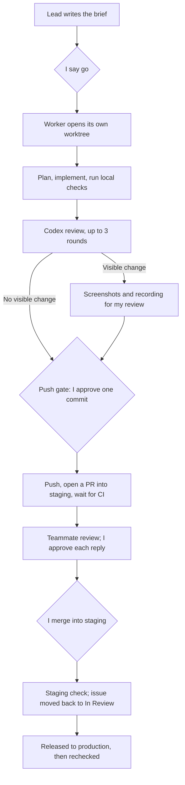
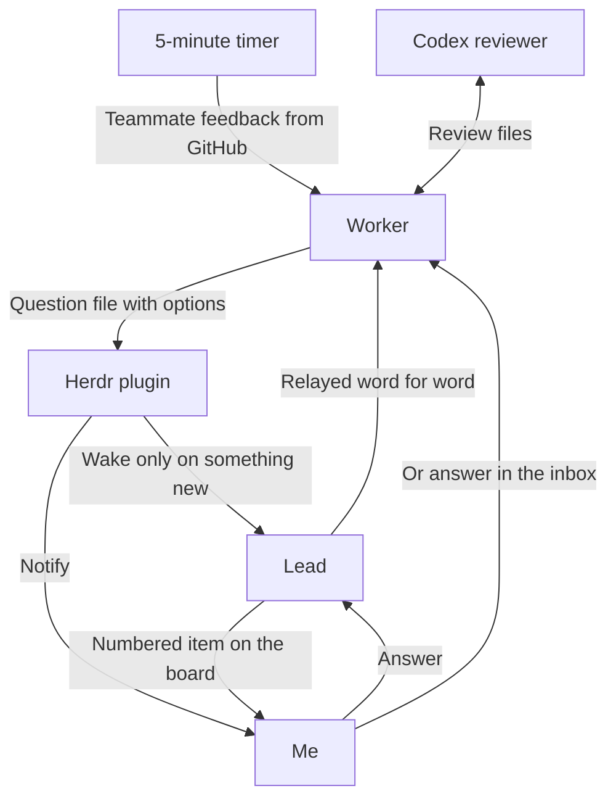
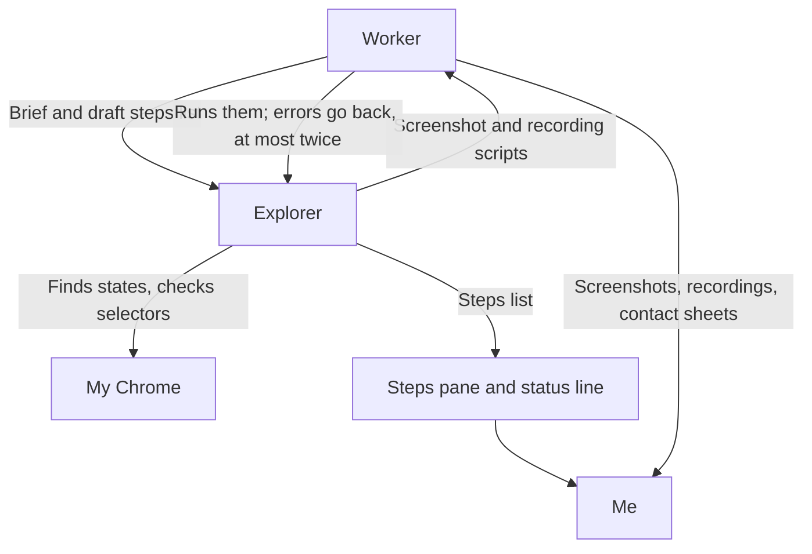

---
authors:
  - Kaibin
---

# Chapter 4: One Board Agent, Many Workers

[Contents](README.md)

## The problem

I usually have several issues in progress at once, and each one needs an agent working in its own copy of the code. Someone has to coordinate those agents: decide what can start, notice when one is stuck, and collect the questions only I can answer. I wanted that coordinator to be an agent too, one that acts as a **board**: it triages, dispatches, and watches, but does not write code.

[Chapter 2](02-agent-loops.md) describes the principles of a coordinating agent. This chapter is one concrete setup, built on [Herdr](https://herdr.dev), an agent multiplexer that runs in the terminal. The configuration lives in the agent-flow repository, which will be shared inside RankAI.

## My approach

The two rules I care about most: the agent that dispatches never touches code, and agents hand work to each other through files, not memory. The first lets the lead run for days. The second lets any agent pick up from the files after a restart. Most of the other rules follow from these two.

### Roles

Herdr has four layers, and the roles below live on different ones: the lead has a workspace of its own, each issue's worker has a worktree workspace, and the reviewer is a pane beside the worker.

<HerdrLayers lang="en" />

| Role | What it is | What it does | What it may not do |
|---|---|---|---|
| Lead | Claude with the `rankai-lead` skill, in its own Herdr workspace | Triages Linear, Slack, and GitHub into a board; writes a brief for each ready issue; starts a worker when I approve; watches workers; cleans up after merge | Write code, push, post without my "send", change issue status or owner, answer for me |
| Worker | Claude with the `rankai-ticket` skill, one per issue, in its own worktree | Everything inside the issue, from brief to merge | Leave the issue's scope, push without my approval |
| Reviewer | Codex, read-only, in a pane beside the worker | Reviews the branch, up to three rounds | Change code; its "ship" is not my approval |
| Explorer | A second Claude in its own Herdr tab, driving my Chrome through Playwright MCP; started only when a page state is hard to find | Finds the states on the real page, checks selectors, and hands the screenshot and recording scripts back to the worker | Click anything in production; deliver screenshots of its own |
| Me | — | Every decision: start, push, merge, external posts, answers | — |

In the first version, one agent both dispatched and wrote code. Splitting them keeps code out of the lead's context and keeps each issue isolated from the others. At most three issues run at once. With one issue in progress, the screen looks like this:

<HerdrScreen lang="en" />

### One issue, end to end

### How messages move

Handoffs happen through files, one directory per issue: the brief, a status line, questions with explicit options, and review requests and results. Agents do not depend on remembering each other's conversations.

The Herdr plugin runs a check whenever an agent's status changes and wakes the lead only when something new happened: a question, a worker that stopped or stalled, or a stale lock. A timer polls every PR of each active issue every five minutes and sends teammates' review comments straight to that issue's worker, as links rather than paraphrases. Items waiting on me get a number and a short label on the board.

### How a visual check runs

For a visible change, the worker follows the `visual-check` skill and produces before and after screenshots and a recording before the push, to one standard: desktop screenshots at 1920×1080 with a red box on the changed element, a mobile view at 375×812, and H.264 recordings with a visible pointer. Every file comes from one shared Playwright helper; the scripts for an issue only open pages, click, and name elements, which is what keeps sizes and marks consistent.

The worker first lists, from the code, every page and state where the change shows up, then writes the steps to walk through as a list, one line per step with the URL and selectors. The list shows at the same time in a pane of the Herdr tab and in the status line, so I follow pages and steps rather than the agent's reasoning. By default the worker writes the scripts itself; only when a state is hard to describe, such as where to click in a signed-in dashboard, does it start the explorer to find it in my Chrome. Before delivery every file is checked for size, codec, and the box, and each recording gets a contact sheet with a frame every two seconds, to confirm that the actions really happened. The recordings go into the PR description.

## Human judgment and validation

The agents carry the work, but these steps wait for me:

- **Start**: a worker begins only after I approve the brief.
- **Push gate**: the worker shows me the commit; my approval names that commit's SHA and covers nothing else. Pushes are capped at about ten a day, because every push runs CI.
- **Screenshots**: for a visible change, I look at the before and after images and the recording before the push. While the explorer works, I follow the steps list in the Herdr pane and watch what it does in my Chrome; it does not touch tabs I already have open. Steps that need a sign-in or a payment are designed to pause the script and wait for me, which has not yet been verified on a real issue.
- **Replies and mentions**: the worker shows me a draft before it answers a review comment or posts anything that mentions someone or asks for a decision. Routine progress comments on the issue go out at milestones without a draft.
- **Merge**: I merge into staging myself. The production release goes through the team's normal process.

A Codex "ship" verdict means the reviewer and the worker agree. It does not replace my approval.

## Results and limitations

This workflow is now my default way of handling a RankAI issue: from brief to merge into staging, my part is concentrated at the decision points of start, push, merge, and replies. Most rules came from things going wrong in real use, and the repository history records each change. The most important one was splitting the lead from the workers: the lead once took screenshots for an issue itself and its context filled up within hours; since the split it does no work inside an issue and can run for days. Another was making briefs quote the issue's definition of done and list what is out of scope, after a worker treated configuration risks outside its issue as part of the job.

The script-based visual check produced the recordings in the PR description for RAN-525; the explorer ran end to end for the first time on 30 October, against this workbook's local dev server, and has not yet been verified on a signed-in RankAI page or a payment step.

The workflow does not fit every task. Research where I have to run the experiments and make the judgment myself goes outside it.

Implementation references, all in the agent-flow repository: the `rankai-lead` and `rankai-ticket` skills, the review rounds in `codex-review`, the screenshot standard and script helper in `visual-check`, and the design notes in `docs/DESIGN.md`.
