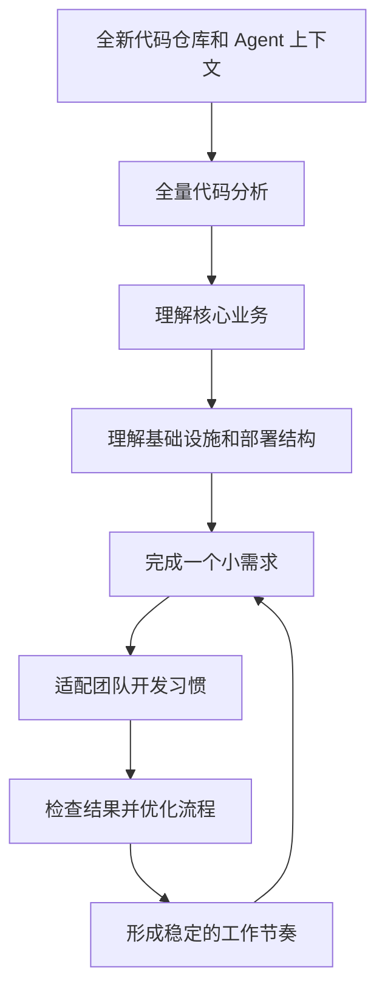
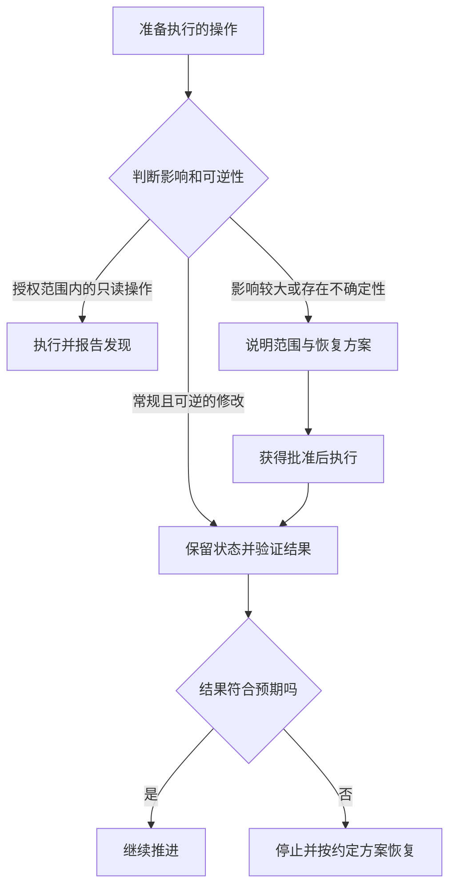

# 第一章：学会放手、判断风险，以及好好说话

*草稿 · 基于我的个人工作实践。*

[English — 主版本](../en/01-working-with-ai.md) · [目录](README.md)

我使用 AI，其实没有什么特别的技巧，也不会一开始就收集各种 MCP、skill 或 plugin。使用 AI 是一个渐进的过程，需要逐步匹配自己的工作习惯。

我只会在实际工作需要时，慢慢加入 Git、GitHub、Linear、Gmail 等工具。它们让 Agent 能接触更多工作环境，但不会自动带来更好的判断或结果。对我来说，接入工具只是表象，真正发生的是：我正在逐渐学会把事情交出去。

开发者通常具备工程敏感性，也有安全意识。这些都是优势。需要调整的是：当我们不再亲手完成每一步时，该如何发挥这些优势。

我的做法可以归纳为三点：

1. 学会放手。
2. 判断风险，并准备好退路。
3. 好好说话，尤其是在事情出错的时候。

## 一、学会放手

有经验的工程师往往希望掌控每个细节。在系统开发中，这种习惯很有价值。但与 AI 一起工作时，我更希望自己像一位技术负责人：明确目标、拆分任务、移除阻碍，并判断结果。

我不希望自己因为舍不得一行漂亮的代码，反复改写和优化，最后成为执行效率的瓶颈。我的经验更应该用于判断：这个模块是否满足需求？行为是否正确？还需要验证什么？

### 以结果为起点做 Review

这听起来像是在放弃责任，但在我看来，是在改变注意力的分配。

无论是人手写还是 AI 生成，都很难穷尽所有边界情况。因此，我会把更多注意力放在行为验证上，思路更接近 QA：核心用户流程必须跑通，重要的失败路径需要考虑，实现也不能偏离原本的需求。

这并不意味着代码质量、安全和架构不再重要，而是从目标行为出发，把深入审查集中在出错后影响最大的地方。我不需要亲自列出所有可能的测试用例，但需要看到核心需求已经满足的证据。

### 给代码整理安排明确的时间

代码腐化确实存在。以我的经验，如果 AI 持续快速修改代码，却没有人回头检查整体结构，这个问题可能更加严重。

我的偏好是在一个较大的版本落地之后，安排专门的整理任务：拆分模块、简化代码、清理积累的复杂度。这同样可以交给 AI 完成。我更愿意把它作为明确的工作，而不是为了尚未证实的优化需求反复打断交付。

这是工作顺序上的选择，不是推迟已知正确性或安全问题的理由。会危及当前版本的缺陷，应当在当前版本解决。

### 把全新的 Agent 当作刚入职的同事

我很喜欢从零开始：新拉取的仓库，加上没有积累对话记忆的 Agent。干净的上下文，让我们可以重新检查代码，而不必继承之前每一轮对话的假设。

我通常按照下面的顺序推进：

这个过程很像新人入职。在我的实践中，它有时快得令人意外：大约一周，就可能从不熟悉项目走到能够做出实质贡献。这是个人观察，并不代表所有仓库和任务都能遵循相同的时间表。

在这个过程中，我会定期找 Agent 学习：这个业务功能做了什么？当初为什么引入？它现在仍然满足需要吗，还是应该迭代？

### 让知识贴近代码

我把代码仓库当作理解现有实现的主要来源。在搭建庞大的独立知识库之前，我更希望 Agent 先检查实际存在的代码。

固定的总结很容易变成继承下来的假设。如果不维护，Agent 可能只是在重复过去的解释，而没有验证它今天是否仍然成立。

这不代表所有文档都是无用功。代码说明系统实际做什么，简洁的文档则可以保留代码无法解释的意图、约束和决策。我偏好精简、贴近当前工作的记录。

一个 task 文件和一个 memory 文件，可以成为有用的工作参考，记录当前目标、关键决定、犯过的错误和最近任务的经验。但它们不能无限增长。我会定期让 Agent 对照代码自查，删除过期内容，只留下对下一次任务有帮助的信息。

## 二、判断风险，并准备好退路

这是工程经验特别有价值的地方。重要的并不只是工作年限，而是操作系统、网络、数据库、算法等知识，让你更清楚什么可以做到，以及什么可能出错。

我把这种能力称为技术上的“想象力”。

有人可能只会说：“让我更方便地使用电脑。”更熟悉系统的人可能会说：“帮我理解并减少不必要的内存占用”，或者：“让我通过一台电脑上的 AI，操作另外几台机器。”

差别不只是表达方式。知道远程访问和 SSH 的存在，会改变你能想到的解决方案；理解状态、资源归属和清理机制，会改变你能识别的故障。

### 发现 Agent 走错方向的时刻

例如，一个 React effect 不断触发自己，或启动订阅、异步任务后缺少合适的清理。不熟悉原理的人可能只看到界面很慢、状态过期，或者应用卡死；有经验的开发者则能提出更有用的排查假设。

我并不打算手动检查所有实现细节。很多时候，Agent 比我更早发现问题。但我会留意方向上的变化：长对话被总结后遗漏了约束、同一条路径反复失败，或者为了绕过一个障碍，采用了会制造更大问题的方案。

这时，一次及时的打断可以很简单：

> 先停一下。原方案失败，不代表可以改变这个约束。请重试原来的路径，或者告诉我需要提供什么权限和信息。

经验让我能拦下无效工作，也让我能区分：这是一个小而可恢复的错误，还是一个真正危险的操作。

### 在重要操作之前想清楚如何恢复

“做个备份”很有用，但还不够。我还希望 Agent 说明：如果失败，怎样恢复到之前的状态？

根据任务不同，可以使用 Git revert、经过恢复验证的数据库备份、快照，或者回滚脚本。它们解决的问题不同。例如，回退代码并不能恢复被删除的生产数据。

在执行影响较大的操作之前，我希望知道：

- 会改动什么，可能影响什么？
- 哪些状态需要保留？
- 如果失败，如何恢复？
- 哪一步需要我明确批准？

### 在明确边界内交出访问权限

只要边界明确，我愿意让 Agent 接触工作资源：大部分时间只读，写入权限有限，影响较大的改动先咨询。

清晰的指令有帮助，但我不会把一句提示词当作安全保证。实际权限和 Agent 的执行控制，也应该支持相同的边界。

这是走向有效委托的重要一步。例如，Slack 总结能告诉我同事聊了什么；同时拥有对话和代码上下文的 Agent，则可以进一步调查客户的一篇文章究竟会如何处理，找到对应实现，并拿出依据解释。

价值来自把问题和正确的上下文连接起来，同时让访问范围与任务相匹配。

## 三、好好说话，尤其是在生气的时候

每个人都会生气。我也曾因为 Agent 表现得不如预期、重复犯错，或者一直道歉却不推进工作，而感到愤怒。

但仅凭这些经历，我无法证明厂商因为我生气就切换到了更弱的模型。我能观察到的是：一段充满指责和道歉的对话，留下的有效工作信息越来越少。

辱骂不会解释 bug，不会补回遗漏的约束，也不会定义什么结果才算合格。它只增加了对话，却没有帮助下一步决策。

因此，我尽量把纠正说得具体：

> 停一下。这个结果违反了以下要求：___。保留当前状态，说明改动了什么，并提出最小修正方案。不可逆的操作请先询问。

Agent 需要清楚的目标、相关上下文，以及判断结果是否合格的方法。当这些都具备时，我就可以让它继续推进，而不必每一步都检查。

如果它提出选择题，而所有选项都不对，我不会硬选一个。我会补充缺失的需求，再让它根据新补充的条件，重新检查已经完成的工作。

对我来说，学会使用 AI，就是逐渐从亲自完成每一步，转向指导工作：给它空间，知道何时介入，并让每一次介入都真正有用。
