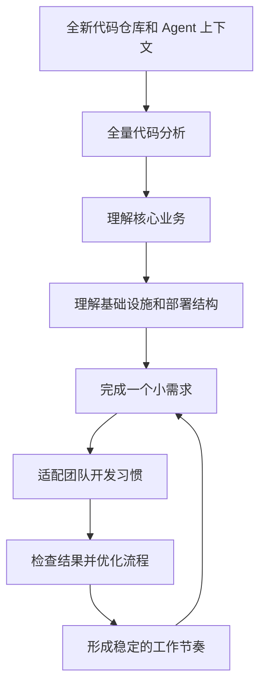
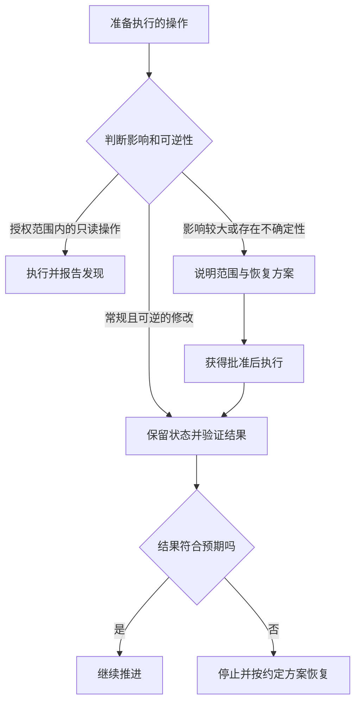

---
authors:
  - mowtwo
---

# 第一章：学会放手、判断风险，以及好好说话

[目录](README.md)

我使用 AI 没有什么特别的技巧。GitHub、Linear、Gmail 这类工具，都是工作中确实需要时才逐渐加入的。工具扩大了 Agent 能接触的范围；学会委托，才决定了我能把多少工作真正交出去。

对我来说，关键是三件事：**学会放手、判断风险、好好说话。**

## 一、学会放手：统筹工作，判断结果

有经验的工程师喜欢掌控细节。与 AI 协作时，我更希望自己像技术负责人：明确目标、分配任务、移除阻碍。不要为了反复打磨一个漂亮的实现，让自己成为瓶颈。

我的 Review 从行为出发：**核心流程是否跑通？是否满足需求？重要的失败路径是否验证过？** 代码质量仍然重要，高风险部分也需要深入审查。但对结果负责，不意味着每一行都要亲手改写。

我更倾向于在较大的版本落地后，集中拆分模块、简化代码，而不是在交付过程中不断提前优化。已知的正确性和安全问题，仍然应当及时解决。

### 通过真实任务，让 Agent 熟悉项目

我喜欢全新的仓库和干净的 Agent 上下文，然后像带新人入职一样推进：

以我的经验，大约一周就可能从不熟悉项目走到能够做出实质贡献。在这个过程中，我会找 Agent 学习：每个业务功能做什么、为什么存在、是否需要迭代。

**代码是我理解项目的起点。** 文档用来保留意图和约束，不能代替检查实现。关键决定和经验可以放进 task、memory 文件，但需要定期让 Agent 清理过期和重复的内容。

## 二、判断风险：知道什么时候介入

工程经验带来一种技术上的“想象力”：知道什么可以做到，也知道什么可能出错。理解内存、网络和远程访问，让我们能提出更具体的目标，也更容易识别 Agent 不合理的捷径。

我会留意约束遗漏、重复失败，以及制造更大问题的临时方案。这时，介入可以很简单：

> 先停一下，保留原来的约束。重试这条路径，或者告诉我需要提供什么信息和权限。

**重要操作之前，我要的是恢复方案，不只是备份。** 会影响什么？哪些状态需要保留？如何恢复？回退代码，并不能找回被删除的生产数据。

我会在明确边界内交出访问权限：大部分时间只读，写入有限，影响较大的操作先确认。指令有帮助，实际权限和执行控制也必须支持这些边界。

价值在于上下文。一个既能读同事的问题、又能读仓库的 Agent，可以直接调查客户的文章会如何处理，而不只是总结聊天记录。

## 三、好好说话：把情绪转化成具体指令

我也会因为反复犯错和不停道歉而生气。但愤怒并没有告诉 Agent 该修什么。我无法仅凭糟糕的体验判断厂商是否降低了模型能力；能看到的是，对话开始不再产生有效信息。

与其指责，不如把纠正说清楚：

> 停一下，这违反了以下要求：___。保留当前状态，说明改动了什么，并提出最小修正方案。不可逆操作请先询问。

如果 Agent 给出的选项全错，就补充缺失的需求，让它重新检查已经完成的部分。明确的目标、相关上下文和验收标准，才能让它持续推进。
