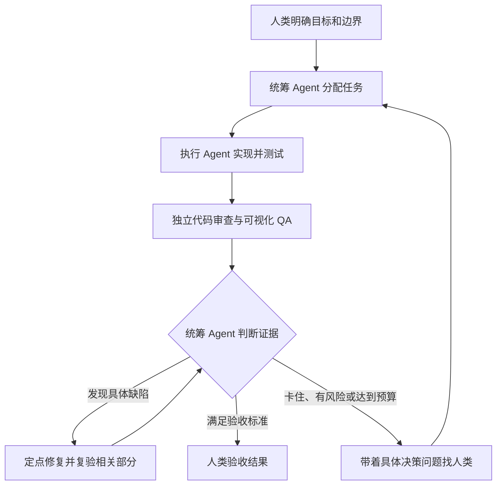

---
authors:
  - Wencheng
---

# 第二章：让 Agent 自主循环起来

[目录](README.md)

学会把任务交出去之后，下一步就是不用再亲自传递每个环节的信息。**在事先约定的边界内，让 Agent 分配工作、检查结果，并判断下一步做什么。**

## 一、让擅长决策的模型负责统筹

我希望有一个判断能力强的模型来协调工作。目前我个人偏好 Opus 5.5：在我的任务里，它的成本和执行效率很有吸引力，有时甚至比 Fable 更合适。这是针对具体工作的体验，不是通用排名；产品信息可参考 [Anthropic 官方说明](https://www.anthropic.com/claude/opus)。

实现方式可以是 Claude Code 的 subagent，也可以围绕 Hermes 搭建需求路由器，或授权统筹 Agent 调用 Codex、Cursor agent 的 CLI。这些是不同的集成方案，并不代表它们无需配置就能互换。

| 角色 | 我交给它的工作 |
|---|---|
| 统筹 Agent | 拆需求、分配任务、判断证据、提交需要人决策的问题 |
| 执行 Agent | 完成范围明确的修改，返回 diff 和测试结果 |
| 独立 Reviewer | 在单独的 session 中检查需求与代码 |
| 可视化 QA Agent | 操作界面，收集截图或录屏中的关键帧 |
| 人类 | 验收结果、澄清歧义、批准影响较大的操作 |

对于范围明确的 review 或可视化 QA，只要表现足够好，我会考虑用 Sonnet 这类成本较低的模型。浏览器工具可以提供交互和截图；录屏、抽帧则需要相应的采集流程。图片能帮助发现界面问题，但不能代替功能验证。

## 二、形成闭环，也设定停止条件

每次派发任务，都要带上需求、范围和完成标准。统筹 Agent 收到的应该是证据，而不只是“做完了”。多个 Agent 同时工作时，可以用独立 worktree 或明确的文件分工避免相互覆盖。

对常规改动，我默认做**一轮独立 Review**，之后针对问题修复和复验。只有出现新证据、较大改动或更高风险时，才增加审查，而不是因为还有 Agent 可用就无限互查。

如果反复把同一套解释传给不同 Agent，它们可能强化共同的假设。我更倾向于让 Reviewer 先看需求、diff 和测试证据，而不是先听执行者解释自己为什么正确。一致认可不等于验证通过，可复现的问题更有价值。

## 三、让巡检保持上下文新鲜

除了开发，我也会让 Agent 定期检查近期错误、失败任务和上次检查后的变化。真正出问题时，这能减少重新收集上下文的成本。

有价值的产出是**带时间戳、能追溯到新证据的摘要**，而不是无限堆积日志。定时巡检只知道上次观察到的状态；日常检查以只读为主，出现有意义的变化再通知，修复建议仍然进入同一套决策流程。

## 四、人可以离开电脑，但仍然能及时介入

我的个人项目 [pane-remote](https://github.com/mowtwo/pane-remote)，就是用手机管理电脑上的 session。它负责让人接入这套流程，本身不是负责决策的模型。

- **集中处理介入点：**会话状态、待办收件箱，以及完成和确认通知。
- **随时找回上下文：**Claude Code、Codex 对话视图，会话分叉和终端操作。
- **手机上验收：**预览本地开发页面和文件，注入工具后的 Agent 可以向我提问，或打开预览。
- **维护有退路：**自检、带保护的更新流程和回滚能力。

这是我用 AI 开发的工具。对已有基础环境的熟练工程师来说，额外部署成本可以低到接近没有。这是我的个人体验，不是零成本保证：文档中的部署需要 macOS、WezTerm 和适当配置的 Tailscale，可选模块还有其他依赖。

它的问题报告机制也体现了一个实用闭环：**发现异常 → 去重 → 通知 → 确认修复 → Agent 处理 → 回报结果**。我可以离开电脑，而不用让所有待决事项都等到我回来。

*实现参考：[Agent 集成](https://github.com/mowtwo/pane-remote/blob/main/docs/agent.md)、[问题报告](https://github.com/mowtwo/pane-remote/blob/main/docs/incidents.md)、[更新逻辑](https://github.com/mowtwo/pane-remote/blob/main/lib/update.mjs)；2026 年 10 月 28 日对照本地源码核查，本章未重新实测部署。*
