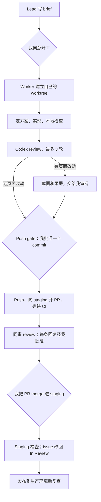
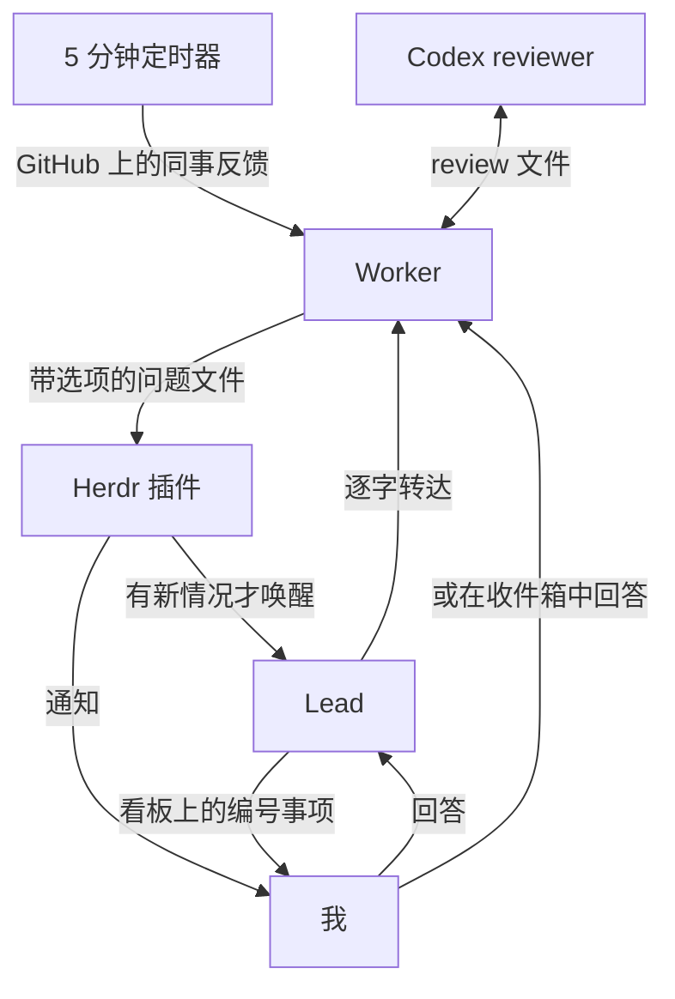
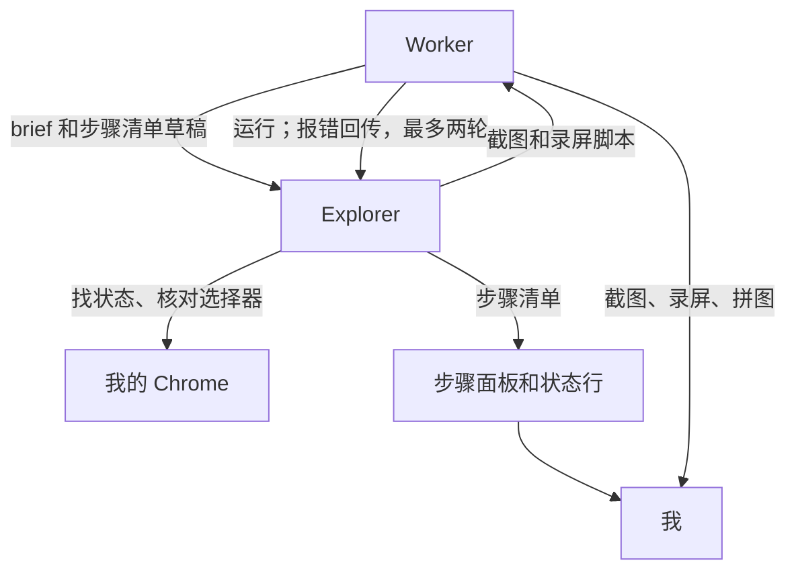

---
authors:
  - Kaibin
---

# 第四章：一个看板 Agent，多个 Worker

[目录](README.md)

## 问题

我通常同时推进几个 issue，每个 issue 都需要一个 agent 在独立的代码副本里工作。这些 agent 需要有人协调：判断哪些工作可以开始，发现哪个 agent 卡住了，把只有我能回答的问题收集起来。我希望协调者本身也是一个 agent，它的角色是一块**看板**：分诊、派单、照看进度，但不写代码。

[第二章](02-agent-loops.md)介绍了协调型 agent 的原则。本章是一个具体的搭法，基于 [Herdr](https://herdr.dev)，一个运行在终端里的 agent 多路复用工具。配置放在 agent-flow 仓库中，之后会在 RankAI 内部共享。

## 我的做法

我最看重的两条是：派单的 agent 不碰代码，agent 之间靠文件交接而不是靠记忆。前一条让 lead 可以连续运行好几天；后一条让任何一个 agent 重启之后，都能从文件里接着做。其余规则大多是这两条的推论。

### 角色

Herdr 的结构有四层，下面的角色分别住在不同的层里：lead 独占一个 workspace，每个 issue 的 worker 占一个 worktree workspace，reviewer 是 worker 旁边的一个 pane。

<HerdrLayers lang="zh" />

| 角色 | 是什么 | 做什么 | 不能做什么 |
|---|---|---|---|
| Lead | 带 `rankai-lead` skill 的 Claude，位于单独的 Herdr workspace | 把 Linear、Slack 和 GitHub 的信息分诊到看板；为可以开工的 issue 写 brief；经我同意后启动 worker；照看 worker；merge 之后清理 | 写代码、push、未经我说“send”就对外发言、修改 issue 的状态或负责人、替我回答 |
| Worker | 带 `rankai-ticket` skill 的 Claude，每个 issue 一个，位于各自的 worktree | 从 brief 到 merge，issue 范围内的全部工作 | 越出 issue 范围、未经我批准就 push |
| Reviewer | 只读的 Codex，位于 worker 旁边的 pane | review 当前分支，最多三轮 | 修改代码；它的“ship”不等于我的批准 |
| Explorer | 另一个 Claude，位于独立的 Herdr tab，通过 Playwright MCP 操作我的 Chrome；只在页面状态难找时启动 | 在真实页面上找到状态、核对选择器，写好截图和录屏脚本交回 worker | 在生产环境中点击任何东西；自己交付截图 |
| 我 | — | 所有决定：开工、push、merge、对外发言、回答问题 | — |

最初的版本由一个 agent 既派单又写代码。拆开之后，lead 的上下文里不再有代码，各个 issue 之间也互相隔离。同一时间最多进行三个 issue。一个 issue 进行中时，屏幕上是这样：

<HerdrScreen lang="zh" />

### 一个 issue 的完整流程

### 消息怎么流转

交接通过文件完成，每个 issue 一个目录：brief、一行状态、带明确选项的问题，以及 review 的请求和结果。agent 之间不依赖记住彼此的对话。

Herdr 插件在任一 agent 状态变化时跑一次检查，只有出现新情况才唤醒 lead：新问题、worker 停止或长时间没有进展、锁已过期。定时器每 5 分钟轮询一次进行中 issue 的全部 PR，把同事的 review 评论直接转给对应的 worker，转的是链接，不是转述。等我处理的事项在看板上带编号和简短标签。

### 视觉检查怎么做

有页面改动时，worker 在 push 之前按 `visual-check` skill 产出改动前后的截图和录屏，标准只有一套：桌面截图 1920×1080，改动的元素套红框；手机视图 375×812；录屏为 H.264，带可见的鼠标指针。所有文件都出自同一个 Playwright 脚本助手，每个 issue 的脚本只负责打开页面、点击和指定元素，尺寸和标注才能一致。

worker 先按代码列出改动出现的每个页面和状态，再把要走的步骤写成一份清单，每步一行，带网址和选择器。这份清单同时显示在 Herdr tab 的一个面板和状态行里，我跟着页面和步骤看，不用读 agent 的思考过程。脚本默认由 worker 自己写；只有状态难以描述时，例如登录后的仪表盘里点哪里，才启动 explorer 到我的 Chrome 里找。交付之前每个文件核对尺寸、编码和红框，每段录屏生成一张每 2 秒一帧的拼图，确认动作真的发生了；录屏放进 PR 描述。

## 人的判断与验证

工作由 agent 推进，但以下环节必须等我决定：

- **开工**：我批准 brief 之后，worker 才开始。
- **Push gate**：worker 把 commit 给我看；我的批准写明这个 commit 的 SHA，只对它有效。push 每天大约以十次为上限，因为每次 push 都会触发 CI。
- **截图**：有页面改动时，我在 push 之前看改动前后的截图和录屏。explorer 工作时，我在 Herdr 面板里跟着步骤清单看它在我的 Chrome 里做什么；它不碰我已经打开的标签页。需要登录或付款的步骤，设计上由脚本暂停、我来操作，这一点还没有在真实 issue 上验证过。
- **回复与 @**：worker 回复 review 评论，或发布任何 @ 别人、请别人做决定的内容之前，先给我看草稿。issue 上按里程碑发的例行进度评论不需要草稿。
- **Merge**：我亲自把 PR merge 进 staging。发布到生产环境按团队的常规流程进行。

Codex 给出“ship”，表示 reviewer 和 worker 达成了一致，不能代替我的批准。

## 结果与局限

这套流程现在是我处理 RankAI issue 的默认方式：从 brief 到 merge 进 staging，我的参与集中在开工、push、merge 和回复这几个决定点上。大多数规则来自实际使用中出现的问题，仓库的提交历史记录了每一次修改。最重要的一次是把 lead 和 worker 拆开：lead 曾亲自为一个 issue 截图，几个小时内上下文就被占满；拆开之后它不再做 issue 范围内的工作，可以连续运行好几天。另一次是 brief 开始原文引用 issue 的完成标准并列出范围外的内容，因为有一个 worker 把范围之外的配置风险当作了分内工作。

视觉检查的脚本路线在 RAN-525 上产出了放进 PR 描述的录屏；explorer 在 10 月 30 日第一次完整跑通，对象是本工作簿的本地 dev server，还没有在需要登录的 RankAI 页面和付款步骤上验证过。

这套流程并不适合所有任务。需要我亲自运行实验、亲自做判断的调研，不走这套流程。

实现参考，均在 agent-flow 仓库：`rankai-lead` 和 `rankai-ticket` 两个 skill，`codex-review` 的轮次规则，`visual-check` 的截图标准和脚本助手，以及设计说明 `docs/DESIGN.md`。
