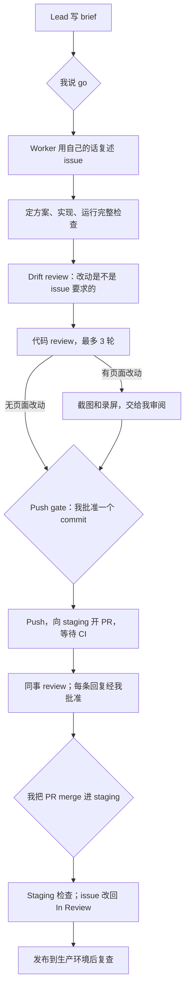
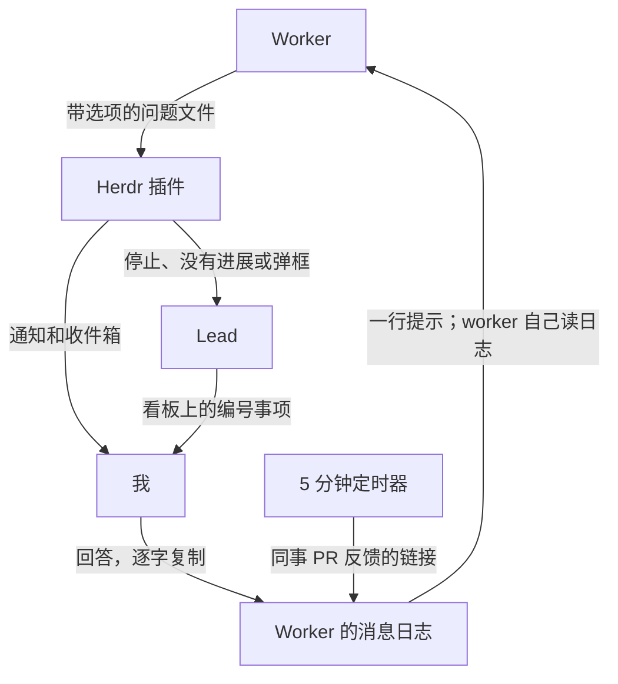
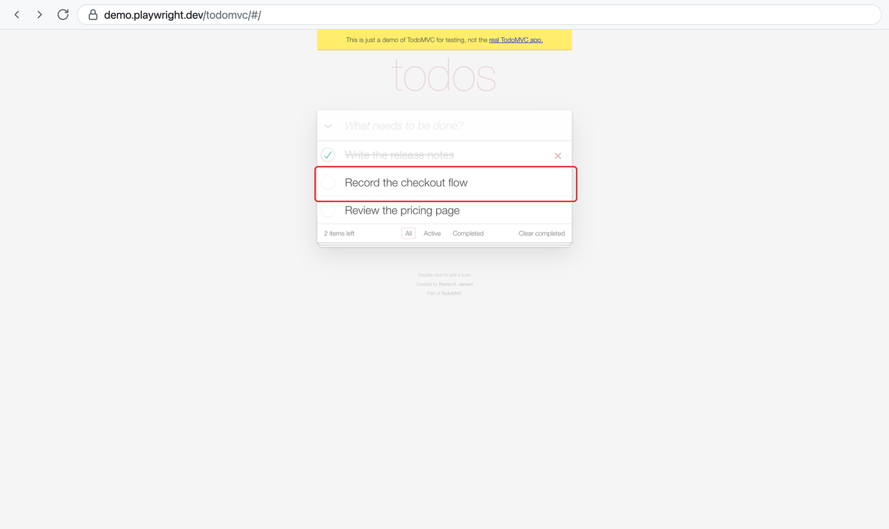

---
authors:
  - Kaibin
---

# 第四章：一个看板 Agent，多个 Worker

[目录](README.md)

## 问题

我通常同时推进几个 issue，每个 issue 都需要一个 agent 在独立的代码副本里工作。这些 agent 需要有人协调：判断哪些工作可以开始，发现哪个 agent 卡住了，把只有我能回答的问题收集起来。我希望协调者本身也是一个 agent，它的角色是一块**看板**：分诊、派单、照看进度，但不写代码。

[第二章](02-agent-loops.md)介绍了协调型 agent 的原则。本章是一个具体的搭法，基于 [Herdr](https://herdr.dev)，一个运行在终端里的 agent 多路复用工具。它放在 [agent-flow](https://github.com/RankaiHQ/agent-flow) 仓库中，已在 RankAI 内部共享：一组 skill 加一个 Herdr 插件，所有名字、路径和上限都集中在一个配置文件里。

## 我的做法

我最看重的两条是：派单的 agent 不碰代码，agent 之间靠文件交接而不是靠记忆。前一条让 lead 可以连续运行好几天；后一条让任何一个 agent 重启之后，都能从文件里接着做。其余规则大多是这两条的推论，第一版之后新增的部分也是：一个只读不写的角色，以及记录 worker 收到的每条消息的日志。

### 角色

Herdr 的结构有四层，下面的角色分别位于不同的层：lead 独占一个 workspace，每个 issue 的 worker 占一个 worktree workspace，review 进行时显示为 worker 旁边的一个 pane。

<HerdrLayers lang="zh" />

| 角色 | 是什么 | 做什么 | 不能做什么 |
|---|---|---|---|
| Lead | 带 `rankai-lead` skill 的 Claude，位于单独的 Herdr workspace | 把 Linear、Slack 和 GitHub 的信息分诊到看板；为可以开工的 issue 写 brief；我说 go 之后启动 worker；worker 停止或长时间没有进展时告诉我；merge 之后清理 | 写代码、push、未经我说“send”就对外发言、修改 issue 的状态或负责人、替我回答 |
| Worker | 带 `rankai-ticket` skill 的 Claude，每个 issue 一个，位于各自的 worktree | 从 brief 到 merge 之后的检查，issue 范围内的全部工作 | 越出 issue 范围；未经我批准就 push 或对外发言 |
| Scout | 带 `rankai-scout` skill 的 Claude，每个问题一个，位于一份不允许改动的代码副本 | 只靠阅读回答一个问题：代码、其他仓库、网页、只执行 SELECT 的 staging 数据库。写一份每条事实都带来源的报告，和一份不超过十行的摘要 | 修改或发出任何东西；决定怎样使用结论 |
| Reviewer | 只读的 Codex，由 worker 调用；worker 旁边的 pane 显示每一轮 | push 之前的两种 review：先看改动是不是 issue 要求的，再看代码。各最多三轮 | 修改文件；它的“ship”不等于我的批准 |
| 插件 | Herdr 插件，只有脚本，没有模型 | worker 提问时通知我；worker 停止、长时间没有进展或遇到弹框时唤醒 lead；把同事在 PR 上的反馈转给对应的 worker；在侧边栏显示每个 worker 所处的阶段 | 批准或回答任何事 |
| 我 | — | 所有决定：开工、push、merge、对外发言、回答问题 | — |

最初的版本由一个 agent 既派单又写代码。拆开之后，lead 的上下文里不再有代码，各个 issue 之间也互相隔离。同一时间最多进行三个 issue，scout 不计入这个上限。一个 issue 处于 review 阶段时，屏幕上是这样：

<HerdrScreen lang="zh" />

### 一个 issue 的完整流程

worker 依次经过十个编号的阶段，并把当前阶段写进一个只有一行的状态文件。lead、插件和侧边栏读取的是这一行，而不是 worker 的屏幕。

图中有几步是出过问题之后才加上的。增加 drift review，是因为代码 review 无法判断改动是不是 issue 要求的那一个。push gate 之前，worker 现在会先检查与 base branch 的冲突：曾有一次 push 落在一个小时前已经出现冲突的 PR 上，CI 没有运行测试，这次 push 的额度白白用掉。“CI 通过”现在只指一项具名的检查，即运行测试的那一项，起因是 lead 曾在只有预览部署通过时，把一个 PR 报告为全部通过。

### 消息怎么流转

交接通过文件完成，每个 issue 一个目录：brief、一行状态、带明确选项的问题、review 的请求和结果，以及发给 worker 的每条消息的日志。agent 之间不依赖记住彼此的对话。

这里有两处细节来自失败的经历。第一，我的回答只复制，不转述。lead 转述时出过两次错，其中一次把 worker 输入框里的灰色占位文字当成了我输入的内容。第二，消息发出不等于已被读到。直接输入到忙碌的 worker 输入框里的回答可能被截断或丢失，因此现在每条消息都追加到日志中，worker 的 pane 只收到一行提示，worker 读完后标记已读。超过 15 分钟仍未读的消息会被报告出来。

Herdr 插件在任一 agent 状态变化时运行一次检查，只有出现新情况才唤醒 lead。定时器每 5 分钟轮询一次进行中 issue 的全部 PR，把同事的 review 评论转给对应的 worker，转的是链接，不是转述。

### 阅读不等于决定

有些问题需要的是事实，而不是我的决定：另一个项目怎样处理某种情况，issue 范围之外的某个发现是否属实。11 月初，这类问题让 lead 的会话被一次核实和两轮调研占满。lead 不应该是负责阅读的那个 agent，worker 也不应该把上下文花在自己的 issue 之外。

因此这类问题交给 scout。它拿到一个问题，和一份固定在某个 commit 上、不允许改动的代码副本。它写一份每条事实都带来源的报告，和一份不超过十行的摘要，lead 只读这份摘要。它不能 commit，不能对外发言，也不能决定怎样使用结论；满两个小时，就把已有的内容写成报告。我用 `scout <问题>` 启动 scout；当某个 issue 缺的是事实而不是决定时，lead 也可以自行启动一个。截至 11 月 13 日，归档中有 13 份 scout 报告。

### Review 是闸门，不是打磨

11 月 3 日，我统计了 15 个 issue 的 review 记录。其中 27 轮 Codex 代码 review 共提出 10 条 finding，全部被修复，每轮耗时四到九分钟。噪音出在别处。某个 issue 的 drift review 第一轮提出 15 条 finding，三轮之后仍未达成一致；在另一个 issue 上，它要求把测试里的一个数字改回计划中的数值。另有一个 Claude reviewer 独立运行自己的循环，它的 finding 约有 40% 被拒绝。

规则随之调整。每条 finding 带严重程度：严重的必须修复，或者有依据地拒绝；轻微的只在修复成本很低时才修；其余只做记录。一轮只带来轻微 finding 即视为“ship”，被拒绝的 finding 不得再次提出。那个 Claude reviewer 现在只在 Codex 第一轮进行的同时把 diff 读一遍，不再有自己的轮次。代码 review 的第一轮只看 diff，不看 worker 的解释，这与[第二章](02-agent-loops.md)的建议一致。调整之后的数据，我还没有重新统计。

### 视觉检查怎么做

有页面改动时，worker 在 push 之前按 `visual-check` skill 产出改动前后的截图和录屏，标准只有一套：页面为 1920×1080，顶部带地址栏；改动的元素套红框；录屏为 H.264，带可见的鼠标指针。带地址栏，是因为网址往往本身就是 reviewer 需要看到的信息；录屏中的地址栏随每次页面跳转更新，看起来像密钥的参数值会被遮盖。所有文件都出自同一个共享脚本，尺寸和标注因此保持一致。

worker 先按代码列出改动出现的每个页面和状态，再把要走的步骤写成一份清单，每步一行。从第一步起，这份清单就显示在 Herdr 的一个 pane 和状态行里，我跟着页面和步骤看，不用读 agent 的思考过程。默认情况下，worker 自己在脚本启动的 Chrome 里找到每个状态，当场截图；录屏，以及需要在改动前后以同样方式重复执行的操作，则写成脚本。只有某个状态必须用到我自己的 Chrome 时，worker 才启动 explorer：另一个位于独立 Herdr tab 的 Claude，它操作这个 Chrome，找到状态，再把步骤和脚本交回 worker。

交付之前，每个文件核对尺寸、编码和红框。每段录屏生成一张由各帧拼成的拼图，用来确认动作真的发生了；console 报错和失败的请求会与改动之前的结果对比。录屏放进 PR 描述。

## 人的判断与验证

工作由 agent 推进，但以下环节必须等我决定：

- **开工**：我对 brief 说 go 之后，worker 才开始。lead 另有一个按规则自动开工的模式，它只替代这一项批准；我还没有开启它。
- **方案**：brief 要求时，worker 写代码之前，其方案须经我确认。
- **Push gate**：worker 把 commit、冲突检查的结果、diff 摘要和两种 review 的结论给我看。我的批准只对这个 commit 有效。push 每天大约以十次为上限，因为每次 push 都会触发 CI。
- **截图**：有页面改动时，我在 push 之前看改动前后的截图和录屏。
- **回复与 @**：worker 回复 review 评论，或发布任何 @ 别人、请别人做决定的内容之前，先给我看草稿。issue 上按里程碑发的例行进度评论不需要草稿。
- **Merge**：worker 完成 merge 检查之后，由我亲自把 PR merge 进 staging。发布到生产环境按团队的常规流程进行。

来自 lead 或插件的消息只是信息，不构成批准。Codex 给出“ship”，表示 reviewer 和 worker 达成了一致，不能代替我的批准。

## 结果与局限

这套流程是我处理 RankAI issue 的默认方式。10 月 23 日至 11 月 13 日，push 日志记录了 40 个 issue 的 66 次 push，没有一天超过十次的上限。我的参与集中在开工、push、merge 和回复这几个决定点上。

大多数规则来自实际使用中出现的问题；仓库里的决定记录有 74 条带日期的条目，每条都写明起因。最重要的一次是把 lead 和 worker 拆开：lead 曾亲自为一个 issue 截图，五个小时内上下文就被占满；拆开之后，它不再做 issue 范围内的工作。另一次是 brief 开始原文引用 issue 的完成标准，其余内容一律不进入 PR，因为有一个 worker 列出了 issue 范围之外的配置风险，引出了一整天与该 issue 无关的讨论。

有一处没有按设计运转。我做了收件箱，目的是回答 worker 的问题时中间不经过模型。实际上我都在 lead 的 pane 里回答：截至 11 月 13 日，回答日志共 199 条，全部经由 lead。lead 逐字复制我的话，所以不存在转述，但每条回答都占用它的上下文。流程后来顺应了这个习惯：worker 提问时也会唤醒 lead，lead 把问题连同 worker 给出的选项列为看板上的编号事项。

有些部分尚未验证。自动模式从未启动过任何 issue。在原对话上恢复一个丢失的 worker，只在模拟的 Herdr 上测试过。视觉检查中需要暂停、由我操作的步骤，例如沙盒付款，还没有在真实 issue 上运行过。

这套流程并不适合所有任务。需要我亲自运行实验、亲自做判断的调研，不走这套流程。

想试用的话，需要 macOS、Herdr、Claude Code 和 Codex CLI；安装步骤见 README，另有一个 setup skill 逐项询问名字、仓库和上限。建议从比完整团队更小的规模开始：在一个 worktree 里，让 Claude 用 `rankai-ticket` skill 处理一个 issue。没有 brief 时，它会根据 Linear 起草一份，先给你看。同时进行的 issue 超过一个时，再加上 lead。

实现参考，均在 agent-flow 仓库：`rankai-lead`、`rankai-ticket` 和 `rankai-scout` 三个 skill，`codex-review` 的轮次规则，`visual-check` 的截图标准和脚本，以 `docs/DESIGN.md` 为目录的设计说明，以及决定记录 `docs/decisions.md`。
