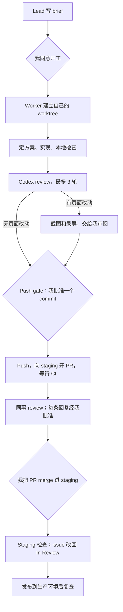
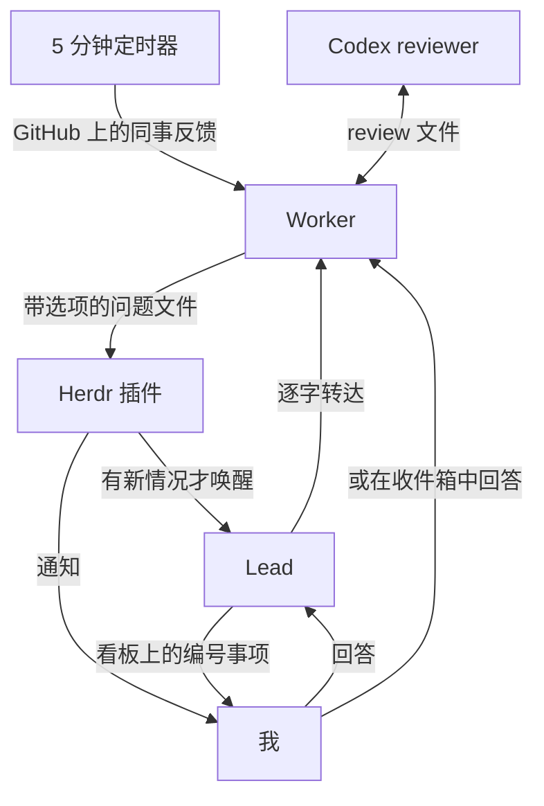
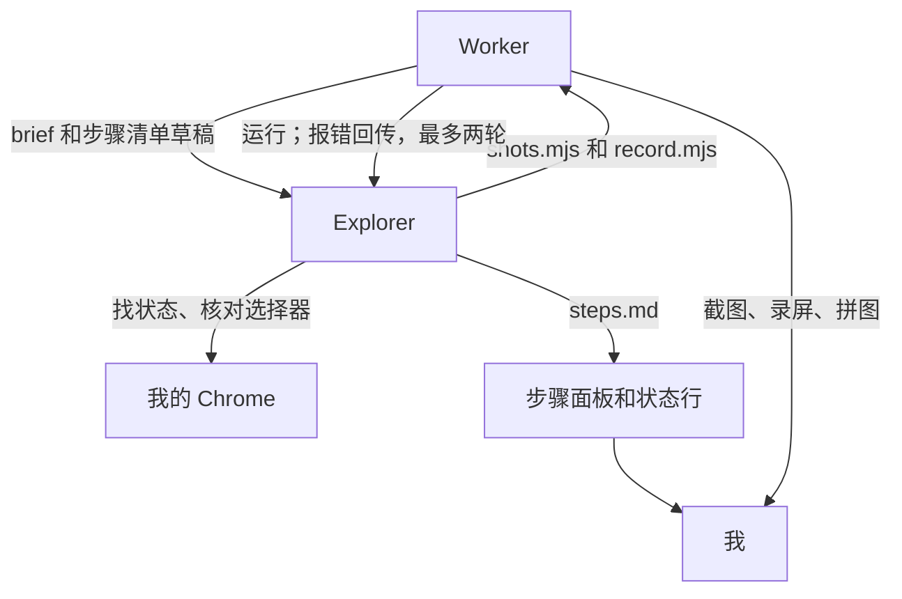

---
authors:
  - Kaibin Chen
---

# 第四章：一个看板 Agent，多个 Worker

[目录](README.md)

## 问题

我通常同时推进几个 issue，每个 issue 都需要一个 agent 在独立的代码副本里工作。这些 agent 需要有人协调：判断哪些工作可以开始，发现哪个 agent 卡住了，并把只有我能回答的问题收集起来。我希望协调者本身也是一个 agent，它的角色是一块**看板**：负责分诊、派单和照看进度，但不写代码。

[第二章](02-agent-loops.md)介绍了协调型 agent 的原则。本章介绍一个具体的搭法，基于 [Herdr](https://herdr.dev)，一个运行在终端里的 agent 多路复用工具。

相关配置放在 agent-flow 仓库中，之后会在 RankAI 内部共享。下文提到的文件路径均相对于该仓库。

## 我的做法

### 角色

| 角色 | 是什么 | 做什么 | 不能做什么 |
|---|---|---|---|
| Lead | 带 `rankai-lead` skill 的 Claude，位于单独的 Herdr workspace | 把 Linear、Slack 和 GitHub 的信息分诊到看板；为可以开工的 issue 写 brief；经我同意后启动 worker；照看 worker；merge 之后清理 | 写代码、push、未经我说“send”就对外发言、修改 issue 的状态或负责人、替我回答 |
| Worker | 带 `rankai-ticket` skill 的 Claude，每个 issue 一个，位于各自的 worktree | 从 brief 到 merge，负责 issue 范围内的全部工作 | 越出 issue 范围、未经我批准就 push |
| Reviewer | 只读的 Codex，位于 worker 旁边的 pane | review 当前分支，最多三轮 | 修改代码；它给出的“ship”不等于我的批准 |
| 视觉检查 | 默认由 worker 自己按 `visual-check` skill 写 Playwright 脚本；状态难找时，另开一个 Claude（explorer），在独立的 Herdr tab 里通过 Playwright MCP 操作我的 Chrome | 列出改动出现的每个位置，维护一份步骤清单，截图和录屏；explorer 在真实页面上找到状态、核对选择器、编写脚本 | 在生产环境中点击任何东西；交付自己截的图（所有交付文件都出自同一个脚本助手，尺寸和标注才能一致） |
| 我 | — | 所有决定：开工、push、merge、对外发言、回答问题 | — |

最初的版本由一个 agent 既派单又写代码。拆开之后，lead 的上下文里不再有代码，可以连续运行好几天；各个 issue 之间也互相隔离（`docs/DESIGN.md`）。同一时间最多进行三个 issue。

### 一个 issue 的完整流程

各阶段及其检查项见 `skills/rankai-ticket/SKILL.md`。review 的轮次规则见 `skills/codex-review/`，截图标准见 `skills/visual-check/`。

### 消息怎么流转

交接通过文件完成，每个 issue 一个目录：brief、一行状态、带明确选项的问题，以及 review 的请求和结果。agent 之间不依赖记住彼此的对话。

Herdr 插件（`herdr-plugin/`）在任一 agent 状态变化时运行一次检查，只有出现新情况才唤醒 lead，例如有新问题、worker 停止或长时间没有进展、锁已过期。定时器每 5 分钟轮询一次各个进行中 issue 的全部 PR，把同事的 review 评论直接转给对应的 worker，转发的是链接，而不是转述。等我处理的事项在看板上带有编号和简短标签；编号不会复用，关闭的事项移入归档。

### 视觉检查怎么做

有页面改动时，worker 在 push 之前产出改动前后的截图和录屏，标准只有一套：桌面截图 1920×1080，改动的元素套红框；手机视图 375×812；录屏为 H.264，带可见的鼠标指针。所有文件都由同一个 Playwright 脚本助手（`skills/visual-check/scripts/visual.mjs`）生成，每个 issue 的脚本只负责打开页面、点击和指定元素。

1. **预检**：ffmpeg、ImageMagick、Playwright 和显示器高度；要用 explorer 时，再探测一次 Chrome 里的 Playwright MCP 扩展。
2. **覆盖表**：按代码而不是按 brief，列出改动出现的每个页面和状态，并注明登录与否。
3. **步骤清单**：一个文件 `steps.md`，每页或每步一行，用中文写，带网址和选择器，行尾的标记表示状态：`→` 正在做、`✓` 到达、`✗` 未到达。同一个文件显示在三处：Herdr tab 右上角的面板（文件一改就重画）、agent 的任务列表、状态行里的 `visual n/N`。我跟着页面和步骤看，不用读 agent 的思考过程。
4. **脚本**：默认由 worker 自己写 `shots.mjs` 和 `record.mjs` 并运行。只有当状态难以描述时，例如登录后的仪表盘里点哪里、哪个项目能看到这个状态，才启动 explorer。它在我的 Chrome 里开自己的标签页，用无障碍快照读页面，找到状态、核对选择器、补全步骤清单，然后写好脚本交回。worker 运行脚本；出错时把报错发回给 explorer 修，最多两轮，仍失败就问我。
5. **检查**：每个文件核对尺寸、编码和红框；每段录屏生成一张每 2 秒一帧的拼图，确认动作真的发生了。
6. **交付**：录屏放进 PR 描述。

## 人的判断与验证

工作由 agent 推进，但以下环节必须等我决定：

- **开工**：我批准 brief 之后，worker 才开始工作。
- **Push gate**：worker 把 commit 给我看；我的批准写明这个 commit 的 SHA，只对它有效。push 每天大约以十次为上限，因为每次 push 都会触发 CI。
- **截图**：有页面改动时，我在 push 之前查看改动前后的截图和录屏。explorer 工作时，我在 Herdr 面板里跟着步骤清单看它在我的 Chrome 里做什么；它不碰我已经打开的标签页。需要登录或付款的步骤，设计上由脚本暂停、我来操作，这一点还没有在真实 issue 上验证过。
- **回复与 @**：worker 回复 review 评论，或发布任何 @ 别人、请别人做决定的内容之前，先给我看草稿。issue 上按里程碑发的例行进度评论不需要草稿。
- **Merge**：我亲自把 PR merge 进 staging。发布到生产环境按团队的常规流程进行。

Codex 给出“ship”，表示 reviewer 和 worker 达成了一致，并不能代替我的批准。

## 结果与局限

大多数规则来自实际使用中出现的问题，仓库的提交历史记录了每一次修改。举三个例子：

- Lead 曾亲自为一个 issue 截图，几个小时内上下文就被占满。此后 lead 不再做 issue 范围内的工作，worker 的问题直接发给我。
- 看板上的事项曾经只有编号，不查找就看不出是什么事。现在每个事项都带标签，编号不再复用。
- 一个 worker 把 issue 范围之外的配置风险当作分内工作处理，团队因此花掉了一天。现在 brief 会原文引用 issue 的完成标准，并列出不在范围内的内容；范围外的发现另开 follow-up issue。

这套流程并不适合所有任务。需要我亲自运行实验、亲自做判断的调研，不走这套流程。

视觉检查走过三版。最初依赖 computer use，有几次运行一张截图都没有产出，截图的尺寸和清晰度也不统一。10 月 28 日改为 Playwright 脚本加同一个脚本助手，在 RAN-525 上产出了放进 PR 描述的录屏。10 月 30 日 explorer 第一次完整跑通，对象是本工作簿的本地 dev server：60 张截图、一段 23 秒的录屏，中间修了两轮脚本。一轮是滚轮事件落在侧边栏上，正文没有滚动；另一轮是浏览器 profile 记住了站点保存的语言设置，之后每次运行都打开中文首页，脚本找不到英文链接。这条路还没有在需要登录的 RankAI 页面和付款步骤上验证过。
